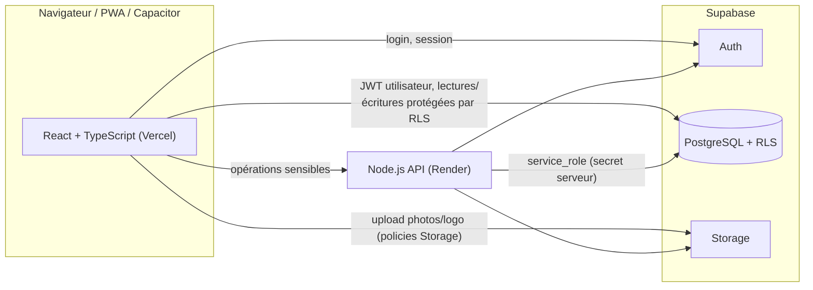
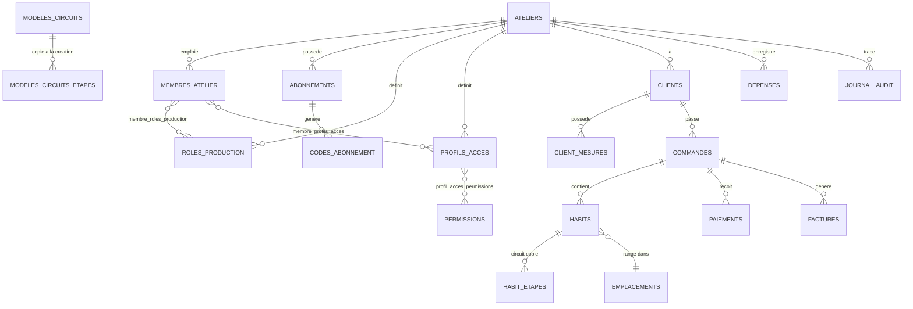

# COUTURE GESTION — ARCHITECTURE (v0.3)

> Source de vérité technique. À consulter avant chaque module.
> Si une nouvelle décision contredit ce fichier : **ne pas trancher seul, signaler la contradiction.**
> Statut : **première implémentation écrite (v0.2), non exécutée ni testée en conditions réelles.** Voir `ETAT_DU_PROJET.md`.
> Les choix ⚠️ de la v0.1 ont été appliqués avec les recommandations de `DECISIONS.md` (section G).

---

## Écarts entre la conception v0.1 et l'implémentation v0.2

- Permissions réellement implémentées : voir `supabase/migrations/0002_permissions_et_helpers.sql` (44 permissions). Changements : `mesures.voir` / `mesures.modifier` (pas de `.creer` séparé), pas de `clients.archiver` (l'archivage passe par `clients.modifier`), ajout de `circuits.gerer`, `modeles.gerer`, `audit.voir`.
- `identifiant_interne` est stocké dans `membres_atelier` (unique par atelier), pas dans `profils`.
- Fonctions SQL préfixées `srv_` : réservées au serveur ; les autres sont des RPC appelables par un utilisateur connecté, avec contrôle interne.
- Écritures sensibles uniquement par RPC : création de commande, prise/fin d'étape, validation finale, paiements, facture, annulations.
- Circuit copié dans l'habit : `creer_commande` copie les étapes du modèle (`circuit_modele_id`) ou reçoit une liste d'étapes personnalisée.
- Migration `0006` : essayages, retouches, paramètres globaux, statistiques (`statistiques_atelier`), export (`exporter_atelier`), photos de profil (bucket `avatars`), suppression de rôle inutilisé.
- Tests : `node:test` côté serveur (au lieu de Vitest) et tests SQL ; pas de Playwright (voir `ETAT_DU_PROJET.md`).

---

## 0. Ce qui a réellement été inspecté

| Élément | Résultat |
|---|---|
| Fichiers du projet | Aucun : répertoire de travail vide, aucun fichier fourni |
| Dépendances, scripts | Inexistants |
| Variables d'environnement (Supabase, Vercel, Render) | Aucune présente dans l'environnement |
| Projet Supabase (base, Auth, Storage, RLS) | **Non inspecté** : aucun accès, aucun projet fourni |
| Déploiement Vercel / Render | **Non inspecté** |
| Documentation officielle Supabase | **Non consultée** pour ce document (voir §14) |

Conséquence : tout ce qui suit est une **proposition de conception**, pas un constat sur un système existant.

---

## 1. Principes

1. **Une seule source d'autorisation : la base de données** (RLS + fonctions SQL). Node.js n'ajoute pas une seconde logique de permissions ; il n'intervient que là où un secret ou un traitement serveur est indispensable.
2. **`atelier_id` sur toutes les tables métier** ; aucune requête ne fait confiance à un `atelier_id` envoyé par le client.
3. **Commande = conteneur commercial. Habit = unité de fabrication.**
4. **Circuit copié dans l'habit** à la création : les modèles de circuits n'ont aucune influence rétroactive.
5. **Archivage plutôt que suppression** pour tout ce qui a un historique.
6. **Journal d'audit append-only**, sans données sensibles inutiles.
7. **`service_role` jamais côté navigateur** (ni `VITE_*`, ni fichier public).

---

## 2. Vue d'ensemble



### Répartition des responsabilités

| Responsabilité | Supabase (direct depuis React) | Node.js (Render) |
|---|---|---|
| CRUD métier courant (clients, commandes, habits, paiements, dépenses…) | ✅ via RLS | ❌ |
| Isolation entre ateliers, permissions, abonnement actif | ✅ RLS + fonctions SQL | ❌ (ne duplique pas) |
| Prise d'étape atomique (« J'ai pris cet habit ») | ✅ fonction SQL transactionnelle | ❌ |
| Authentification propriétaire / Super Admin (email) | ✅ Supabase Auth | ❌ |
| Création de comptes employés, reset mot de passe employé, désactivation + révocation de sessions | ❌ | ✅ (API admin Auth) |
| Génération / vérification des codes d'abonnement, limitation des tentatives | ❌ | ✅ |
| Recherche publique client (sans compte) | ❌ (jamais d'accès `anon` aux tables) | ✅ |
| Génération PDF (factures, reçus) | ❌ | ✅ |
| URLs signées pour photos privées servies au public | ❌ | ✅ |
| Création du premier Super Admin | ❌ | ✅ script d'initialisation, hors frontend |

---

## 3. Frontend (Vercel)

```text
src/
├── app/            # routing, providers, layouts (public, atelier, superadmin)
├── features/
│   ├── auth/  ateliers/  abonnements/  employes/  roles-permissions/
│   ├── clients/  mesures/  commandes/  habits/  circuits/  production/
│   ├── rendez-vous/  paiements/  factures/  depenses/  notifications/
│   ├── tableau-de-bord/  espace-client/  superadmin/
├── components/     # UI réutilisable (boutons, cartes, formulaires, toasts)
├── hooks/  services/  api/  lib/  types/  utils/  config/
```

- Un dossier `features/<module>` contient pages, composants, hooks et services du module (aucun gros fichier).
- Garde de routes : session → statut du compte → abonnement actif → permission. **Ces gardes servent à l'affichage ; la sécurité réelle est en base.**
- Interface en français, montants en **FCFA (XOF)** sans décimales, dates affichées en **Africa/Bamako**, téléphones saisis localement et stockés en **E.164**.
- Navigation : barre inférieure sur mobile, menu latéral sur ordinateur.
- Photos : compression côté navigateur avant envoi ; upload avec reprise/erreur claire (voir §10).
- Compatible PWA puis Capacitor : pas de dépendance à un routage ou à des API navigateur non portables ; accès réseau centralisé dans `services/` et `api/`.

---

## 4. Backend Node.js (Render)

```text
server/src/
├── routes/        # un fichier par domaine (employes, abonnements, public, pdf…)
├── controllers/
├── services/      # logique métier serveur
├── middleware/    # auth JWT, rôle super_admin, rate limit, validation, erreurs
├── lib/           # clients Supabase (user-scoped / service_role), logger
└── config/        # lecture des variables d'environnement, validation au démarrage
```

Règles :
- Chaque route authentifiée **valide le JWT** Supabase, puis charge l'atelier **depuis la base**, jamais depuis le corps de la requête.
- Quand c'est possible, le serveur appelle la base **avec le JWT de l'utilisateur** (RLS appliquée). `service_role` seulement pour les actions qui l'exigent (création de compte Auth, codes, recherche publique, PDF).
- Validation des entrées (schémas) sur chaque route ; messages d'erreur homogènes ; aucun mot de passe, code ou jeton dans les logs.
- Limitation de débit (IP + clé fonctionnelle) sur : activation de code, recherche publique, connexion employé, mot de passe oublié.

---

## 5. Modèle de données (proposition)

### 5.1 Relations principales



### 5.2 Tables

| Groupe | Tables (toutes avec `atelier_id` sauf mention) |
|---|---|
| Plateforme | `super_admins` (sans atelier), `permissions` (catalogue global, sans atelier) |
| Ateliers & accès | `ateliers`, `profils` (identité, 1:1 avec `auth.users`), `membres_atelier` (**`user_id` unique → un seul atelier**), `roles_production`, `membre_roles_production`, `profils_acces`, `profil_acces_permissions`, `membre_profils_acces` |
| Abonnements | `abonnements`, `codes_abonnement`, `tentatives_code`, `abonnements_historique` |
| Clients | `clients`, `mesure_champs` (définition extensible), `client_mesures` |
| Catalogue | `types_vetements`, `modeles` |
| Circuits | `modeles_circuits`, `modeles_circuits_etapes` |
| Fabrication | `commandes`, `habits`, `habit_etapes` (circuit copié + prise/fin d'étape), `emplacements` |
| Planning | `capacite_atelier`, `rendez_vous` (propositions, motifs de refus) |
| Argent | `paiements`, `factures`, `depenses` |
| Transverse | `notifications`, `journal_audit` |

### 5.3 Points de conception importants

- **Identité** : `profils.id = auth.users.id`. Le rattachement à l'atelier est la ligne de `membres_atelier` (jamais déduit de l'email).
- **Employé sans email** : `profils.identifiant_interne` (ex. `MONTEUR-001`), unique **par atelier**.
- **Mesures** : `mesure_champs(categorie ∈ homme|femme|garcon|jeune_fille, libelle, unite)` + `client_mesures(client_id, champ_id, valeur)`. Ajouter une mesure = ajouter une ligne de définition, pas une migration. Chaque habit garde un **instantané** (`habits.mesures_utilisees`, JSON) pour que modifier le profil client ne change pas un habit déjà lancé.
- **`habit_etapes`** : `habit_id, ordre, nom, mode ∈ personne|role, user_id?, role_id?, statut ∈ en_attente|disponible|en_cours|terminee, pris_par, role_utilise_id, pris_a, termine_a, duree_secondes`. Une étape devient `disponible` quand la précédente est `terminee`.
- **Identifiants lisibles** : `CMD-000123`, `HAB-000123`, numéros de facture, générés par séquence **par atelier** (table de compteurs avec verrou), uniques par `(atelier_id, code)`.
- **Montants** : entiers en FCFA (`bigint`), pas de flottants. `reste = total − somme(paiements)` calculé, pas saisi.
- **Dates** : `timestamptz` (UTC). Africa/Bamako étant UTC+0 sans changement d'heure, l'affichage est simple, mais la conversion reste explicite dans `utils/`.
- **Archivage** : `archived_at` (ou `statut`) sur clients, employés, commandes, habits, rôles. Clés étrangères en `ON DELETE RESTRICT` sur tout ce qui porte un historique.
- **Données de démonstration** : uniquement dans un atelier marqué `est_demo = true`, exclu de la liste publique, des statistiques globales et des abonnements réels. Jamais de données de démo injectées dans un atelier réel.
- **Index** : `(atelier_id, …)` sur toutes les tables métier ; index sur `habits(code)`, `clients(telephone_e164)`, `habit_etapes(statut, role_id)`.

---

## 6. Authentification

| Population | Mécanisme |
|---|---|
| Propriétaire, Super Admin | Supabase Auth, email + mot de passe, vérification d'email, récupération par lien |
| Employé **avec** email | Idem |
| Employé **sans** email ⚠️ | Compte Supabase Auth créé par l'API Node (API admin) avec une adresse interne **technique non routable** dérivée de `code_atelier` + `identifiant_interne`. L'employé saisit **code atelier + identifiant + mot de passe** ; l'interface fait la correspondance, le mot de passe reste géré par Supabase Auth. |

Pour l'employé sans email :
- Mot de passe temporaire généré par le serveur, affiché **une seule fois** au propriétaire ; `profils.doit_changer_mdp = true` force le changement à la première connexion.
- Pas de « mot de passe oublié » par email : le propriétaire réinitialise via l'API (action tracée dans l'audit).
- Aucun mot de passe stocké ailleurs que dans Supabase Auth ; jamais dans les logs.

**Désactivation d'un membre** : (1) `membres_atelier.statut = desactive` (bloque immédiatement toute lecture via RLS), (2) blocage du compte Auth, (3) révocation des sessions. Un JWT déjà émis peut rester valide jusqu'à son expiration : c'est la **vérification du statut dans les politiques RLS** qui coupe l'accès sans attendre.

**Premier Super Admin** : script d'initialisation exécuté en local ou sur le serveur, avec identifiants fournis par variables d'environnement au moment de l'exécution, puis retirés. Procédure documentée dans `docs/INITIALISATION.md` (à écrire au module 02). Aucun compte ni secret dans le code source.

---

## 7. Abonnements et codes

Distinction validée :
- **Validité du code** : période pendant laquelle il peut être activé (`valide_jusqu_a`).
- **Durée de l'abonnement** : `duree_jours`, qui **commence à l'activation**.

Cycle :
1. Super Admin crée un abonnement `en_attente_activation` (atelier, durée, fenêtre d'activation).
2. Le serveur génère un code (aléatoire cryptographique, format type `CG-XXXX-XXXX-XXXX`), **ne stocke que son empreinte** (HMAC avec secret serveur) et l'affiche **une seule fois** au Super Admin ⚠️.
3. Le propriétaire saisit le code → Node vérifie, limite les tentatives, puis appelle une fonction SQL **atomique** : `UPDATE … WHERE statut = 'non_utilise' AND now() <= valide_jusqu_a AND atelier_id = <atelier du JWT> RETURNING …`. Zéro ligne modifiée = refus (déjà utilisé, expiré, autre atelier, désactivé), avec un message volontairement peu détaillé côté public.
4. L'abonnement passe `actif`, `debut_at` = activation, `fin_at` calculée ⚠️ (règle de comptage des jours à confirmer, voir `DECISIONS.md`).
5. Chaque étape alimente `abonnements_historique` (qui, quoi, quand).

Expiration — **point d'architecture essentiel** : comme React parle directement à Supabase, vérifier l'expiration dans Node ne suffit pas. La fonction SQL `abonnement_actif(atelier_id)` est appelée **dans les politiques RLS** de toutes les tables métier. Sans abonnement actif (jamais activé, expiré, désactivé) : plus aucune lecture/écriture métier, même par appel direct à l'API Supabase. Seuls restent accessibles : le profil, l'écran « saisir le code », l'activation.

Anti brute-force : `tentatives_code` (utilisateur, atelier, IP, horodatage) ; verrouillage temporaire après N échecs ⚠️ (valeurs à choisir).

---

## 8. Permissions

### 8.1 Trois notions distinctes

| Notion | Rôle | Exemple |
|---|---|---|
| **Rôle de production** | Décide qui peut recevoir quelles **étapes** | Coupeur, Monteur… |
| **Permission** | Décide ce qu'on peut **faire dans l'application** | `commandes.creer` |
| **Profil d'accès** ⚠️ | Regroupe des permissions pour les attribuer facilement | « Secrétaire » |

Le **propriétaire** a implicitement toutes les permissions de son atelier. ⚠️ Le modèle « profil d'accès » est ma proposition pour concilier le Prompt 03 (où « Secrétaire » est un rôle portant des permissions) et la décision validée (rôles de production séparés des permissions).

### 8.2 Anti-élévation de privilèges (obligatoire, en base)

- Un membre ne peut pas modifier **ses propres** profils d'accès ni permissions.
- Il ne peut attribuer / inclure dans un profil **que des permissions qu'il possède lui-même** (et ayant `roles.gerer` / `employes.gerer`).
- Le propriétaire ne peut être ni désactivé, ni rétrogradé, ni voir ses droits modifiés par un autre membre.
- Ces règles sont dans des fonctions SQL / triggers, **pas seulement** dans Node.

### 8.3 Matrice (catalogue initial)

Une permission n'est créée que si une fonctionnalité réelle la protège (colonne « Module »).

| Code | Description | Module |
|---|---|---|
| `clients.voir` / `.creer` / `.modifier` / `.archiver` | Clients | Clients |
| `mesures.voir` / `.creer` / `.modifier` | Mesures | Clients |
| `commandes.voir` / `.creer` / `.modifier` / `.annuler` | Commandes | Commandes |
| `habits.voir`, `habits.voir_circuit`, `habits.confirmer_termine` | Habits et validation finale | Habits |
| `production.prendre`, `production.terminer_etape` | Prise et fin d'étape | Production |
| `emplacements.gerer` | Rangement | Habits |
| `rendez_vous.voir` / `.gerer` | Planning et capacité | Rendez-vous |
| `paiements.voir` / `.enregistrer` / `.modifier` | Paiements | Paiements |
| `factures.voir` / `.generer` / `.partager` | Factures | Factures |
| `depenses.voir` / `.creer` / `.modifier` | Dépenses | Dépenses |
| `employes.voir` / `.creer` / `.modifier` / `.desactiver` | Employés | 03 |
| `roles.voir` / `.creer` / `.modifier` / `.attribuer` | Rôles et profils d'accès | 03 |
| `parametres.modifier` | Paramètres atelier | 02 / suivants |

Hors matrice : tout ce qui concerne le Super Admin (`super_admins`), abonnements et codes. **Aucun profil d'atelier ne peut recevoir ces droits.**

---

## 9. Exemples de politiques RLS (⚠️ à valider sur un vrai projet)

> Exemples de conception. **Non exécutés, non testés.** À écrire, relire et tester (pgTAP ou équivalent) au module concerné.

```sql
-- Fonctions utilitaires (schéma privé, SECURITY DEFINER, search_path figé)
create function private.mon_atelier_id() returns uuid
  language sql stable security definer set search_path = '' as $$
  select atelier_id from public.membres_atelier
  where user_id = auth.uid() and statut = 'actif'
$$;

create function private.abonnement_actif(p_atelier uuid) returns boolean
  language sql stable security definer set search_path = '' as $$
  select exists (
    select 1 from public.abonnements
    where atelier_id = p_atelier and statut = 'actif'
      and now() >= debut_at and now() < fin_at
  )
$$;

create function private.a_permission(p_code text) returns boolean
  language sql stable security definer set search_path = '' as $$
  select exists (select 1 from public.membres_atelier m
                 where m.user_id = auth.uid() and m.statut = 'actif' and m.est_proprietaire)
      or exists (select 1
                 from public.membre_profils_acces mp
                 join public.profil_acces_permissions pp on pp.profil_acces_id = mp.profil_acces_id
                 where mp.user_id = auth.uid() and pp.permission_code = p_code)
$$;

-- Exemple : lecture des clients
alter table public.clients enable row level security;

create policy clients_select on public.clients for select to authenticated
using (
  atelier_id = private.mon_atelier_id()
  and private.abonnement_actif(atelier_id)
  and private.a_permission('clients.voir')
);

-- Exemple : création (atelier_id imposé, jamais lu depuis le client)
create policy clients_insert on public.clients for insert to authenticated
with check (
  atelier_id = private.mon_atelier_id()
  and private.abonnement_actif(atelier_id)
  and private.a_permission('clients.creer')
);
```

Prise d'étape atomique (un seul gagnant) :

```sql
-- Esquisse : update conditionnel ; 0 ligne retournée = « déjà prise »
update public.habit_etapes
set statut = 'en_cours', pris_par = auth.uid(), role_utilise_id = p_role_id, pris_a = now()
where id = p_etape_id and atelier_id = private.mon_atelier_id()
  and statut = 'disponible'
  and /* éligible : étape assignée à moi, ou j'ai le rôle exigé et p_role_id correspond */
returning id;
```

Le journal d'audit : `insert` autorisé uniquement via fonctions serveur ; **aucune politique `update` / `delete`** ; révocation explicite des droits correspondants.

---

## 10. Storage

| Bucket | Contenu | Accès |
|---|---|---|
| `logos` | Logos d'atelier | ⚠️ lecture publique possible (non sensible) ; écriture limitée au chemin `<atelier_id>/…` du propriétaire |
| `photos-habits` | Photos d'habits et de modèles | **Privé** ; chemin `<atelier_id>/<habit_id>/…` ; lecture par RLS Storage ; affichage public via **URLs signées courtes** émises par Node |
| `documents` | Factures PDF, exports | **Privé**, même schéma de chemin |

- Validation : types MIME autorisés (jpeg, png, webp), taille maximale, vérification côté serveur du type réel.
- Compression avant upload ; en cas d'interruption, l'interface propose de reprendre ; le fichier n'est rattaché à l'habit qu'une fois l'upload confirmé.
- Les chemins contiennent l'`atelier_id` : les politiques Storage comparent le premier segment du chemin à l'atelier de l'utilisateur.

---

## 11. Espace client public (sans compte)

- Aucun accès `anon` direct aux tables. Tout passe par **une route Node dédiée**.
- Parcours : choisir un atelier **visible** (`ateliers.visible_public = true`, défaut `false`) → rechercher par **ID d'habit**, ou par **nom / prénom / téléphone**.
- Réponse **minimale** : photo habit, photo modèle, statut, circuit, étape actuelle. Jamais : montants, téléphone, adresse, employés, notes internes, autres clients. ⚠️ Détail du masquage des noms à valider.
- Anti-abus : limitation de débit par IP et par atelier, délai croissant, réponses de forme identique « aucun résultat » / « résultat », plafonnement du nombre de résultats, journalisation des abus (sans stocker de données personnelles inutiles).
- ⚠️ Risque assumé : une recherche par nom/prénom seuls peut retourner plusieurs personnes. Mesures proposées dans `DECISIONS.md`.

---

## 12. Déploiement et environnements

| Brique | Hébergement | Variables (noms uniquement) |
|---|---|---|
| Frontend | Vercel | `VITE_SUPABASE_URL`, `VITE_SUPABASE_ANON_KEY`, `VITE_API_URL` |
| Backend | Render | `SUPABASE_URL`, `SUPABASE_ANON_KEY`, `SUPABASE_SERVICE_ROLE_KEY`, `CODE_HMAC_SECRET`, `ALLOWED_ORIGINS`, `APP_TIMEZONE` (= `Africa/Bamako`), `NODE_ENV`, `PORT` |
| Données | Supabase | Projet distinct pour **développement** et **production** |

- `SUPABASE_SERVICE_ROLE_KEY` et `CODE_HMAC_SECRET` : **uniquement sur Render**, jamais dans Git, jamais dans Vercel.
- CORS restreint au domaine du frontend ; HTTPS obligatoire en production.
- Migrations SQL versionnées dans `supabase/migrations/` ; aucune modification manuelle en production sans migration.

---

## 13. Stratégie de tests (à mettre en place module par module)

| Niveau | Contenu |
|---|---|
| Unitaires | Calcul des durées, montants/restes, comptage des jours d'abonnement, génération des codes |
| Intégration | API Node + base (vraie base de test) |
| **Sécurité (RLS)** | Atelier A ≠ B ; permissions ; abonnement expiré / désactivé ; code utilisé deux fois ; brute-force ; membre désactivé ; modification d'ID ; accès direct à l'API Supabase sans passer par l'interface |
| Concurrence | Deux prises d'étape simultanées : un seul succès |
| End-to-end | Parcours : création atelier → activation → employé → commande → production → validation → facture |

Les outils exacts (Vitest, Playwright, pgTAP ou équivalents) sont **proposés, pas encore validés**.

---

## 14. Éléments non vérifiés / risques à confirmer

1. **Comportement exact de Supabase** pour : création de comptes avec adresse interne non routable, blocage de compte, révocation de sessions, durée de vie des JWT, politiques Storage par chemin. À confirmer dans la documentation officielle et sur un projet réel avant d'écrire le module concerné.
2. **Offres gratuites** de Supabase / Render : mise en veille possible (démarrage lent du backend), quotas de stockage et de bande passante. À vérifier selon l'offre choisie.
3. **Latence réseau** depuis Bamako vers la région choisie pour Supabase et Render : région à choisir et à mesurer.
4. **Limites d'envoi d'emails** de Supabase Auth (vérification, récupération) : à vérifier ; un fournisseur SMTP dédié peut devenir nécessaire.
5. Les politiques RLS de la §9 sont des **exemples non exécutés**.
6. **Génération PDF** : bibliothèque non choisie (rendu fiable des accents, du logo et du FCFA à tester).
7. **Ouverture directe de WhatsApp** avec message prérempli : fonctionne par lien ; il n'y a **pas d'envoi automatique**.

---

## 15. Évolutions prévues (ne pas bloquer)

- **PWA** : manifeste, service worker, cache des ressources statiques.
- **Mobile natif** : Capacitor autour du même code React.
- **Hors connexion** : file d'actions locale et synchronisation, prévus plus tard ; les identifiants générés côté serveur et les écritures idempotentes évitent un refactor.
- **Sauvegarde / export** d'un atelier : export structuré par atelier (module dédié).

---

## 16. Journal des modifications

| Version | Date | Changement |
|---|---|---|
| 0.1 | 02/10/2026 | Création : intégration des décisions validées, proposition de conception, avant tout code |
| 0.2 | 04/10/2026 | Première implémentation (migrations, API, frontend) ; écarts documentés ci-dessus |
| 0.3 | 05/10/2026 | Modules complémentaires (essayages, retouches, statistiques, Super Admin complet, export, PWA de base, démo) |
